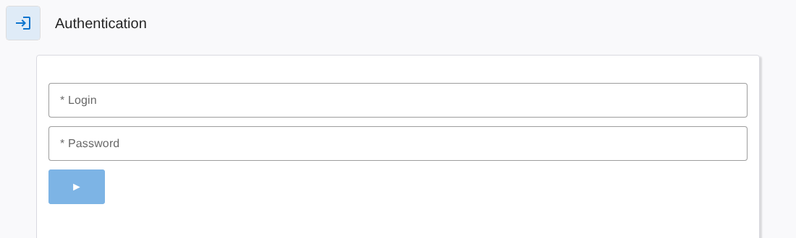

# Opta Equipments dashboard — user guide

This guide explains how to use the Opta Equipments dashboard, from daily monitoring to the administration pages. For the installation of the application, see the [main README](../README.md).

> Screenshots are taken on a demo instance, with the French interface. The interface language is set per user (English or French); the French translation is currently the most complete one.

## Contents

| Page | Guide | Who can open it |
|---|---|---|
| Authentication | [Signing in](#signing-in) | Everyone |
| Map | [map.md](map.md) | Everyone |
| Counters | [counters.md](counters.md) | Everyone |
| Programs | [programs.md](programs.md) | Everyone |
| Detail | [detail.md](detail.md) | Everyone |
| List | [list.md](list.md) | Technician, Technician manager, Administrator |
| Tree | [tree.md](tree.md) | Technician manager, Administrator |
| Linx inkjet printers | [linx.md](linx.md) | Technician manager, Administrator (setup) |
| Users | [users.md](users.md) | Administrator |
| System | [system.md](system.md) | Administrator |
| Telegram bot | [telegram.md](telegram.md) | Users with a Telegram name |

## Vocabulary

The application describes a factory as a tree:

- **Plant**: a site. Each plant has its own time zone, teams, holidays and map.
- **Line**: a production line of a plant.
- **Equipment**: a machine of a line, identified by a unique number.
- **Family**: a group of similar equipments, shared by all plants. Maintenance counters are defined per family.
- **Device**: the hardware that reads or drives equipments (Arduino Opta, Teracom TCW122B-CM, Linx printer, local server).
- **Component**: one value of an equipment read from, or sent to, a device terminal: running state, heating state, hour meter, cycle counter, heating command…

## Signing in

Open the dashboard address in a browser. The **Authentication** page is shown as long as you are not signed in.

Enter your login and password, then press the ► button. Once signed in, the menu bar shows the pages your level gives access to, and the Authentication page lets you sign out.

A session stays open for the duration set by the administrator in the [System](system.md) page (6 hours, 24 hours or 30 days).

## User levels

| Level | Typical use |
|---|---|
| Production | Monitoring pages |
| Production manager | Monitoring pages |
| Technician | Monitoring pages, lists, counter reset |
| Technician manager | Same as Technician, plus most of the Tree page |
| Administrator | Everything, including plants, devices, users and system |

A user can be attached to one plant: this user then only sees that plant. A user without plant (usually administrators) selects the plant at the top of each page.

## Colour code

The same colours are used on every page:

| Colour | Meaning |
|---|---|
| Green | On: running, heating, jet running, counter below 75 % |
| Red | Off: stopped, not heating, counter at 100 % or more, maintenance threshold reached |
| Orange | Intermediate: counter between 75 % and 100 %, or a line where only some equipments are heating |
| Grey | Unknown: the device is offline, or there is no data |
