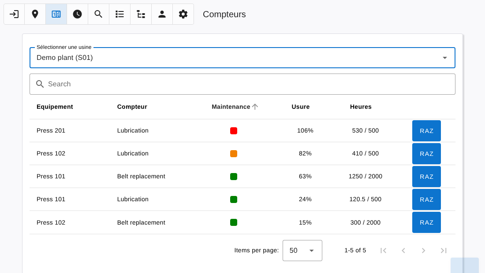

# Counters

[← Back to contents](README.md)

The **Counters** page follows the maintenance counters of the selected plant.

A counter is a maintenance operation to do every given number of running hours, for example a lubrication every 500 hours. Counters are defined per [family](tree.md#counters): every equipment of the family gets its own copy of the counter, fed by its total hour meter.

| Column | Content |
|---|---|
| Equipment | Name of the equipment |
| Counter | Text of the counter |
| Maintenance | Green below 75 %, orange from 75 %, red at 100 % or more |
| Wear | Hours done as a percentage of the limit |
| Hours | Hours done / limit |
| Reset button | Sets the counter back to zero once the maintenance is done |

The list is sorted with the most worn counters first, and can be filtered with the search field.

- Click a row to open the [Detail](detail.md) page of the equipment (Technician and above).
- The **Reset** button asks for a confirmation. It is available to Technician, Technician manager and Administrator levels.

An equipment appears here only if it belongs to a family having counters and if it has a *total hour meter* component.
