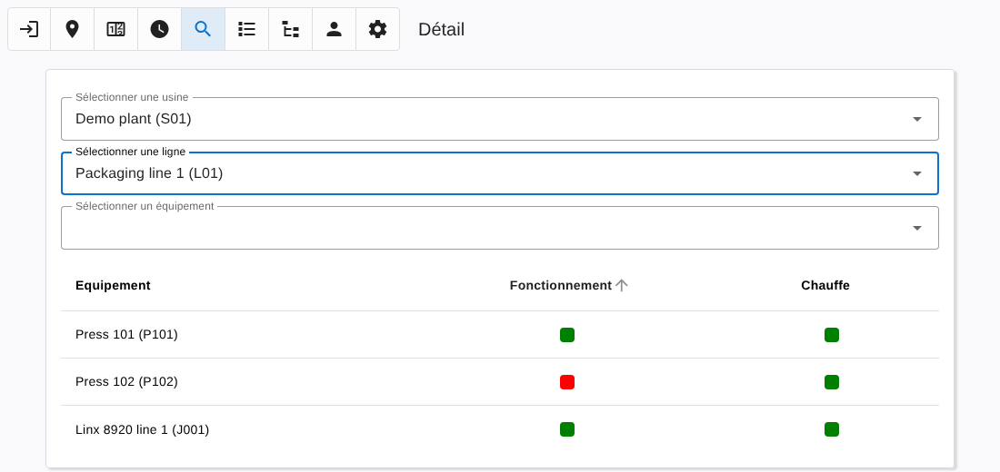
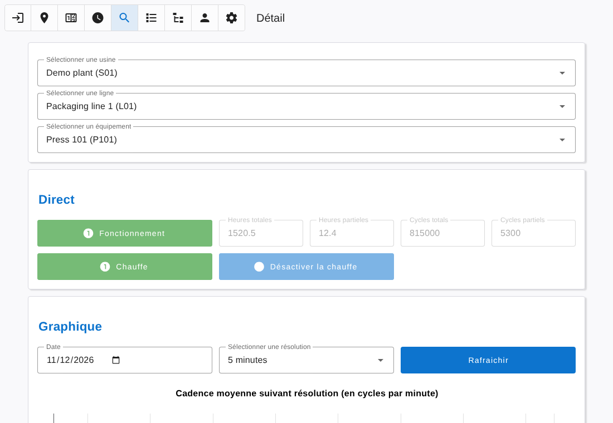

# Detail

[← Back to contents](README.md)

The **Detail** page shows everything known about one equipment.

## Selecting an equipment

Select the plant (if you are not attached to one), then the line. The equipments of the line are listed with their running and heating states.

Click an equipment, or pick it in the third selector.

## Equipment view

The groups shown depend on the components of the equipment.

### Live

Current values, refreshed as they change:

- **Run**: running state, total and partial hour meters, and a button to reset the partial hour meter.
- **Cycle**: cycle state, total and partial cycle counters, and a button to reset the partial counter.
- **Heat**: heating state, and the heating command when the equipment has one.
- Voltage and power, or the server load values for the local server equipment.

Buttons are grey and disabled when the device of the equipment is offline.

### Chart

Pick a date and a resolution, then **Refresh**:

- mean rate in cycles per minute, on the chosen resolution;
- mean rate in cycles per minute, per hour of the day;
- mean running state.

### Counters

The maintenance counters of the equipment, with the same colours and reset button as the [Counters](counters.md) page.

### Programs

The teams during which the line of the equipment is heated (see [Programs](programs.md)).

### Historic

The changes of the running and heating states over the last 24 hours.

## Linx inkjet printers

For a Linx printer the labels are adapted (Printing enabled, Jet, Jet hours, Maintenance in, Total prints, Message prints). The rate charts and the Programs group are not shown. See [linx.md](linx.md).
