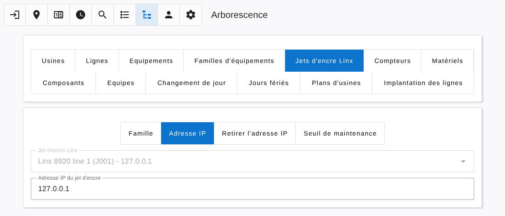
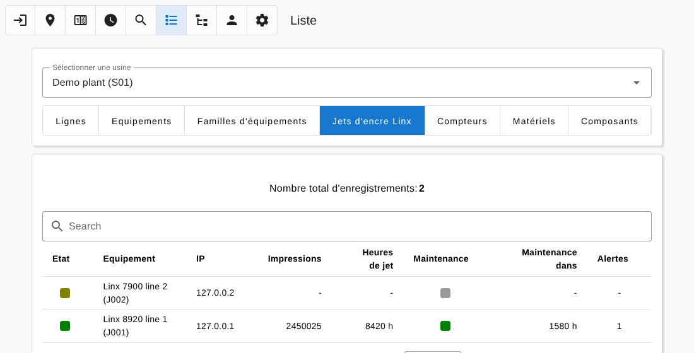
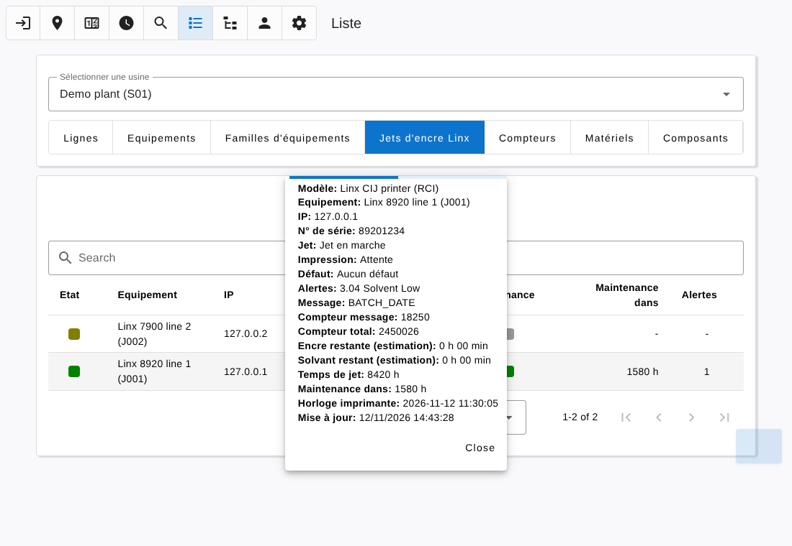

# Linx inkjet printers

[← Back to contents](README.md)

Linx continuous inkjet printers (5900, 7900, 8800, 8900 series, CJ400, Linx 10) can be read over the network with the Linx Remote Communications Interface (RCI), on TCP port 29043. The application polls each printer every 10 seconds.

## On the printer

- Enable **RCI over Ethernet** in the communications setup of the printer, with the checksum enabled (default).
- Give the printer a fixed IP address, reachable from the server.

## In the dashboard

Linx printers are ordinary equipments: create them, or import them, in the [Tree](tree.md) page like any other equipment, and put them all in the same family.

Then open **Tree → Linx inkjet printers**:

| Action | Use |
|---|---|
| Family | Choose the family that holds the Linx printers. It can be changed later. |
| IP address | Choose a printer of this family and enter its IP address. The address can be changed at any time. |
| Remove IP address | Stop polling a printer. |
| Maintenance threshold | Number of hours left before maintenance under which a printer is flagged (500 by default). |

Saving an IP address creates the device of the printer, named after the equipment identifier. The printer is polled as soon as it is in the Linx family and has an IP address.

## Components

To follow a printer like the other equipments, add its components in **Tree → Components → Add**, with the model *Linx CIJ printer (RCI)*, the device of the printer, input `0` and contact NO:

| Group | Component | Printer value |
|---|---|---|
| Run | Running state | Printing enabled (printing or waiting for a trigger) |
| Run | Total hour meter | Jet running hours |
| Run | Hours before service | Hours left before maintenance |
| Heat | Heating state | Jet running |
| Pulse | Cycle state | Prints occurred since the last poll |
| Pulse | Partial cycle counter | Print count of the current message |
| Pulse | Total cycle counter | Total print count |

Hour values are refreshed once a minute.

## Linx list

**List → Linx inkjet printers** shows the printers of the plant, whether they have components or not.

| Column | Content |
|---|---|
| State | Green: jet running. Red: jet stopped. Grey: printer unreachable or without IP address. |
| Prints | Total print count |
| Jet hours | Jet running hours |
| Maintenance | Green, or red when the hours left are under the threshold |
| Maintenance in | Hours left before maintenance |
| Alerts | Number of current printer warnings |

Click a row to see the full information of the printer: serial number, jet and print states, fault, warnings with their Linx event code, current message, counters, estimated ink and solvent left, printer clock.

The same information is available from the Devices list.

## In the Detail page

Labels are adapted for a Linx printer. The rate charts and the Programs group are hidden: a printer is polled, so the application does not record each print.
