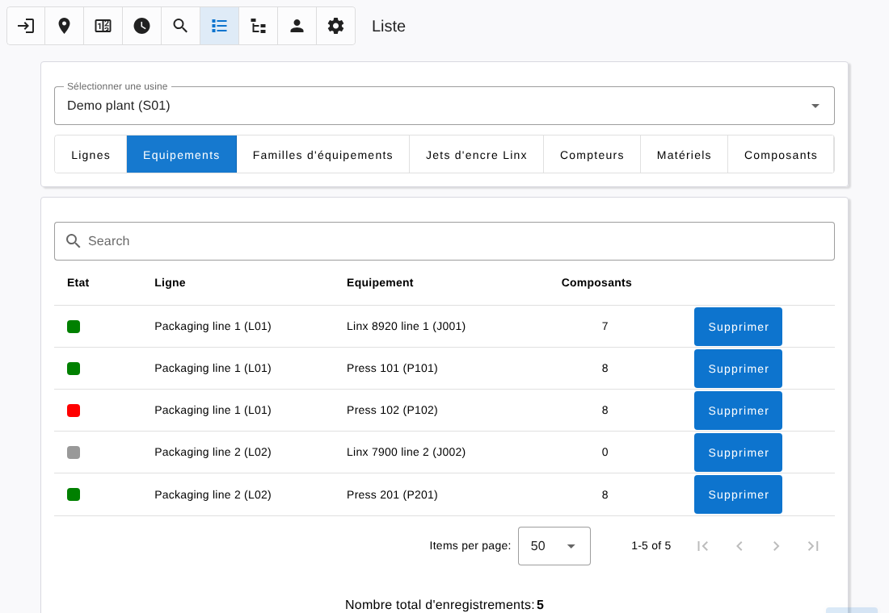
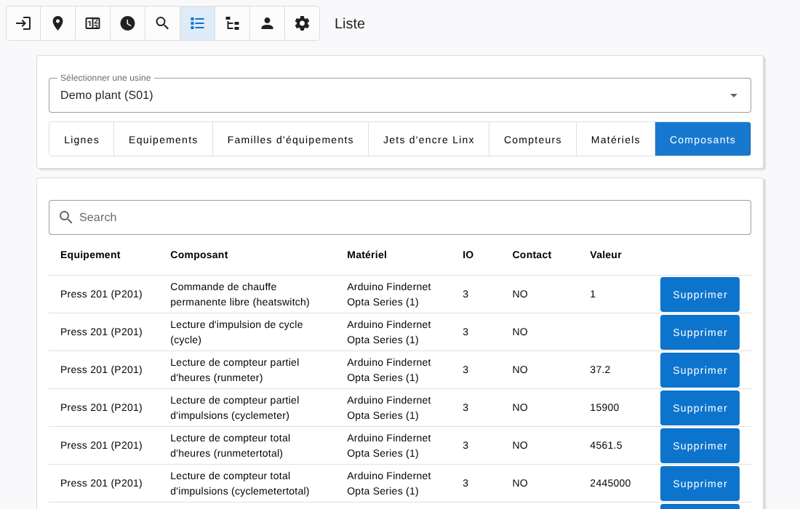

# List

[← Back to contents](README.md)

The **List** page gives tables of what is declared for the selected plant. It is open to Technician, Technician manager and Administrator levels.

Select a plant, then a list. Every table has a search field and shows its number of records.

| List | Content |
|---|---|
| Lines | Lines of the plant |
| Equipments | Equipments with their running state, line and number of components |
| Equipment families | Families with their number of equipments and counters (shared by all plants) |
| Linx inkjet printers | Linx printers of the plant, see [linx.md](linx.md) |
| Counters | Maintenance counters |
| Devices | Devices with their connection state, model and the equipments they serve |
| Components | Every component with its device, terminal, contact type and current value |
| Holidays | Holidays of the plant |

## Actions

- The **Delete** button of a row removes the item, with the same rules as in the [Tree](tree.md#deleting) page.
- In the **Devices** list, click a row to see the information of the device (model, address, last contact…).
