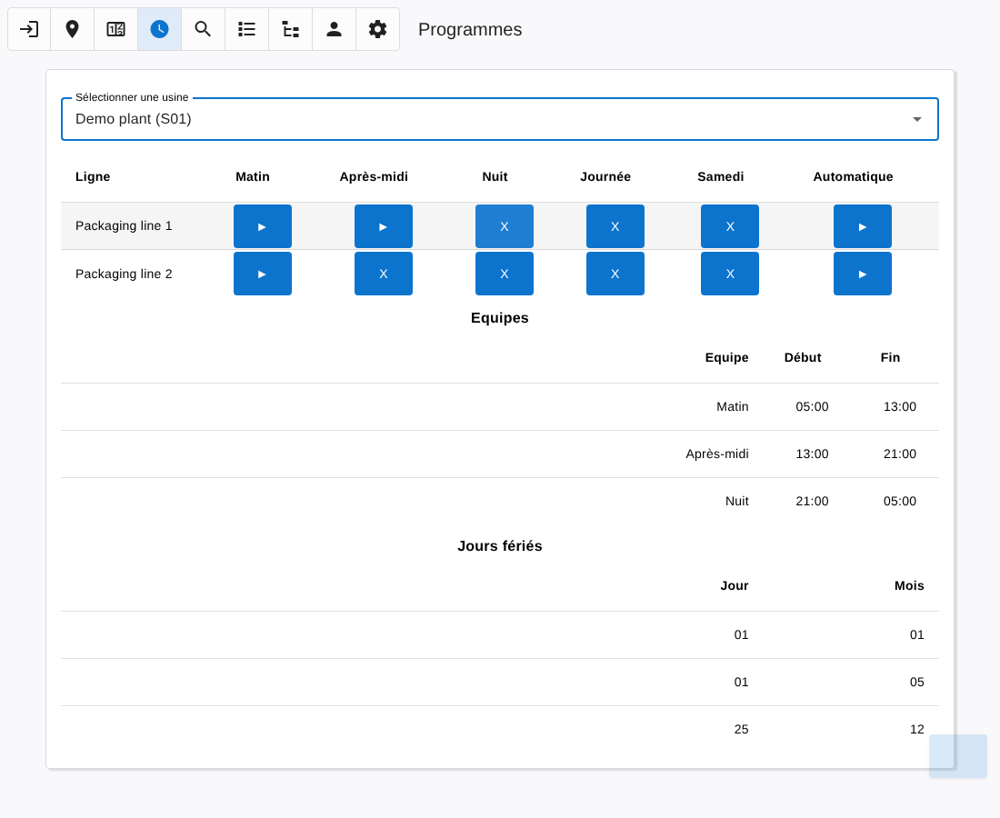

# Programs

[← Back to contents](README.md)

The **Programs** page sets when the lines of a plant are heated automatically.

Only the lines having at least one equipment with a heating command component are listed.

## How it works

- Each plant has **teams** (Morning, Afternoon, Night, Day, Saturday) with a start and an end time.
- For each line, you choose the teams that work on it. While one of these teams is on duty, the heating of the line is switched on; otherwise it is switched off.
- Morning, Afternoon, Night and Day teams apply from Monday to Friday, the Saturday team applies on Saturday.
- On a **holiday** of the plant, no team is on duty.
- A running equipment is never switched off by the program.

## Using the table

| Button | Meaning |
|---|---|
| ► in a team column | The line is heated during this team. Click to disable. |
| X in a team column | The line is not heated during this team. Click to enable. |
| ► in the Automatic column | The program drives the heating of the line. |
| X in the Automatic column | The program is suspended for this line (manual mode). |

Click the name of a line to open the [Detail](detail.md) page on this line.

The team schedule and the holidays of the plant are recalled under the table. They are set in the [Tree](tree.md#teams-day-change-and-holidays) page.
