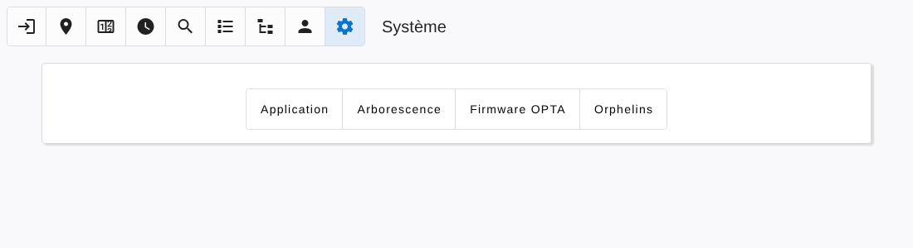

# System

[← Back to contents](README.md)

The **System** page is reserved to administrators.

## Application

- **Icon**, **owner** and **name** shown in the dashboard.
- **Watchdog**: number of seconds without news after which a device is considered offline (120 by default).
- **Session duration**: 6 hours, 24 hours or 30 days.
- **Update to MQTT / from MQTT**: publish every change of the application data to the MQTT broker, and accept changes coming from it.
- **Enable commands to devices**: when unchecked, the application keeps reading the devices but sends them nothing: no output command, no counter reset, no watchdog and no firmware update to the Opta devices, no relay command to the Teracom modules. Use it to run a second instance beside the production one. Setting the environment variable `OPTA_COMMANDS=false` disables commands whatever this option says.
- **Reload application**: restarts the application logic.

## Tree structure

The whole description of the factory (plants, lines, equipments, components, settings…) can be:

- **saved** to, and **restored** from, the backup file of the server;
- **exported** to, and **imported** from, a JSON file on your computer.

A last form deletes one single entry of the application data by its type and identifier. It bypasses the usual protections: use it only to repair an inconsistent tree.

## Opta firmware

Upload an OptaLinker firmware and its version number to update the Arduino Opta devices over the air.

## Orphans

Lists the data left behind by deleted items (component of an unknown equipment, setting of an unknown line, counter of an unknown family…) and cleans them, one by one or all at once.
