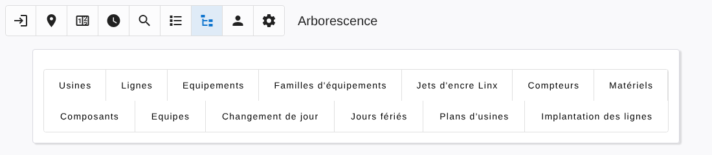
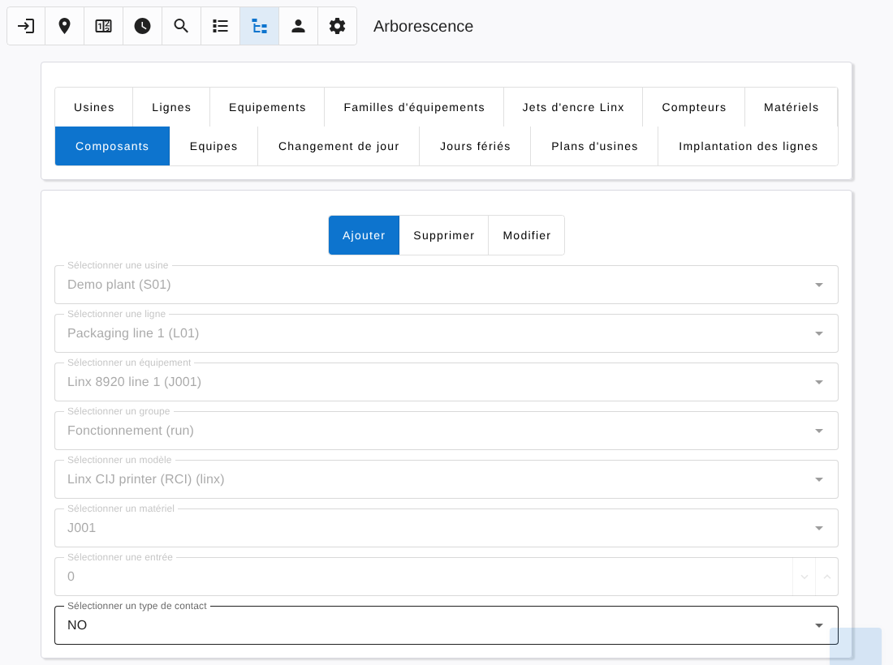

# Tree

[← Back to contents](README.md)

The **Tree** page is where the factory is described. It is open to Technician manager and Administrator levels. The Plants, Devices, Holidays and Plant maps sections are reserved to administrators.

Choose a section, then an action (Add, Delete, Edit, Import). The forms are filled step by step: each answer unlocks the next field, and the last button saves.

## Plants

A plant has an identifier, a name and a time zone. Identifiers cannot be changed afterwards.

## Lines

A line belongs to a plant and has an identifier and a name. Editing a line lets you rename it or move it to another plant.

## Equipments

An equipment belongs to a line and has an identifier, a name and, optionally, a family. Editing lets you rename it, move it to another line or change its family.

## Equipment families

A family has an identifier (a free one such as `FE0001` is suggested) and a name. Families are shared by all plants.

## Importing from a CSV file

Lines, equipments and families can be imported from a CSV file:

- the separator is `;`, values may be enclosed in double quotes;
- the first row holds the column titles;
- the file is read as UTF-8, or Latin-1 otherwise.

After choosing the file, select which column holds each piece of data (identifier, name, and for equipments the line and the family). The first value of each column is shown as an example. Then choose whether existing items are kept or replaced. A summary gives the number of items added, replaced and ignored.

## Counters

A [maintenance counter](counters.md) belongs to a family and has an identifier, a number of hours (100 to 10 000) and a text describing the operation.

## Devices

A device is declared by its model and its identifier:

| Model | Identifier |
|---|---|
| Arduino Finder Opta (OptaLinker firmware) | Device number set in the firmware |
| Teracom TCW122B-CM | IP address of the module |
| Local server | Any identifier |
| Linx inkjet printer | Created automatically, see [linx.md](linx.md) |

## Components

A component links one value of an equipment to a terminal of a device.

To add components, select the plant, the line and the equipment, then:

1. **Group**: the kind of values to create (Run, Pulse, Heat, Power, System…). A group creates every component of the group that the device model supports — for example Run creates the running state, the hour meters and their reset command.
2. **Model** and **Device**.
3. **Input** number on the device (and output number for commands). Use `-1` when there is none.
4. **Contact type**: NO (normally open) or NC (normally closed, the value is inverted).

*Delete* removes one component of an equipment. *Edit* changes the type or the contact type of an existing component.

## Teams, day change and holidays

These settings are per plant and are used by the [Programs](programs.md):

- **Teams**: start and end time of each team (Morning, Afternoon, Night, Day, Saturday). A team may end after midnight.
- **Day change**: the hour at which a production day starts, used by the daily charts.
- **Holidays**: days of the year, as month and day, on which no team is on duty.

## Plant maps and Line locations

- **Plant maps**: upload the image of the plan of a plant.
- **Line locations**: place a line on this plan with a label, a position (x, y) and a size (width, height).

They feed the [Map](map.md) page.

## Deleting

Deleting is protected to avoid losing data by mistake:

- deleting a **plant** moves its lines to the reserved plant *Sans usine* (S99);
- deleting a **line** moves its equipments to the reserved line *Sans ligne* of the plant;
- an **equipment** or a **device** can only be deleted once it has no more components;
- a **family** having counters cannot be deleted; otherwise its equipments become without family.

The reserved plant and lines cannot be deleted.
