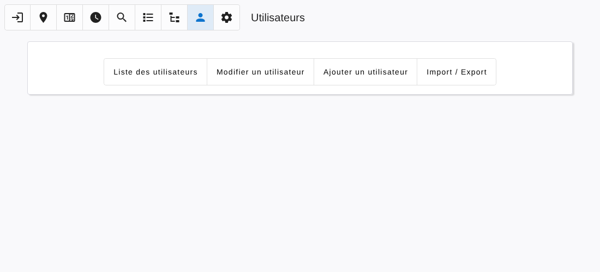

# Users

[← Back to contents](README.md)

The **Users** page is reserved to administrators.

| Section | Use |
|---|---|
| Users list | Every user with its session state, level and plant |
| Edit a user | Change the password of a user |
| Add a user | Create a user |
| Import / Export | Save the users to a file, or restore them from a file |

A user has:

- a **login** and a **password**;
- a **language** (English or French);
- a **level**, see [User levels](README.md#user-levels);
- a **plant**: leave it empty for a user who may select any plant;
- a **Telegram** name, optional, to use the [Telegram bot](telegram.md). Several names can be given, separated by commas.

The first administrator is created from the `OPTA_ADMIN_USERNAME` and `OPTA_ADMIN_PASSWORD` environment variables when no administrator exists.
